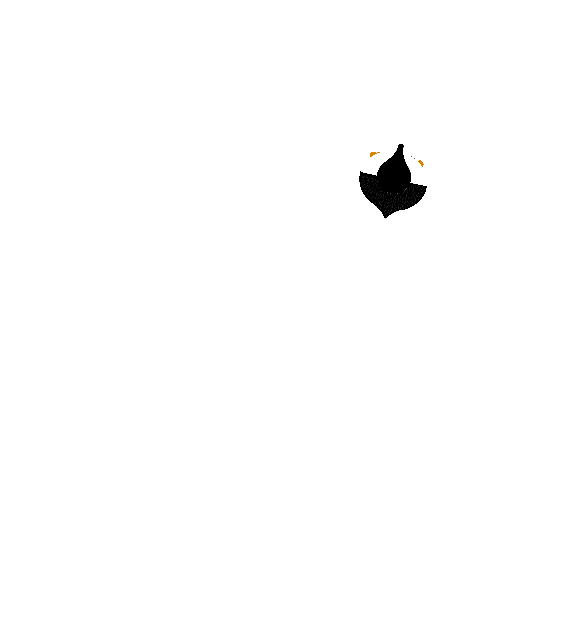
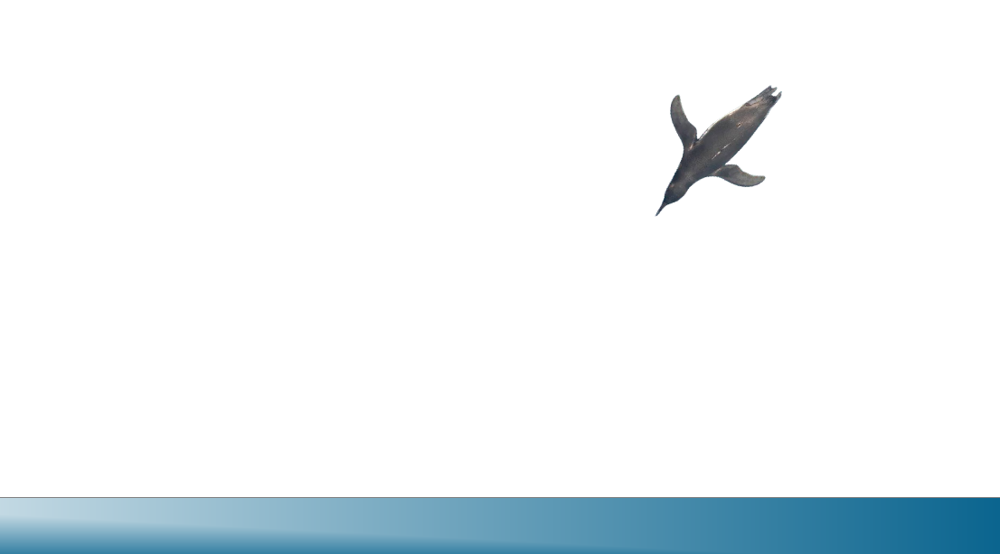

# Desktop Penguin

A penguin that waddles around your desktop
둥글둥글 귀엽네

Terra Week #1 & #2

[LATEST RELEASE](https://github.com/Alex-SJuice/Desktop-Penguin/releases/tag/v2.0.0)

It's made with rust + raylib, entirely from scratch mostly because I didn't feel like figuring out procedural animation in godot. It has some pretty cool physics schenanigans going on lol

There were 2 versions:

there's also one made in godot, and follows the (playground tutorial)[https://playground.hackclub.com/stardance/setup] from stardance, but it is no longer being worked on.

## How to run

1. download the zip
2. extract the zip, and run the executable **DO NOT MOVE THE IMAGES**
3. enjoy!

## Features

 - top down view
 - randomly wanders around the screen
 - procedural art
 - flingable
 - is penguin
 - slides around on belly sometimes
 - comes to investigate your mouse when curious

### Maybe

 - footprint effects 
 - diving animation
 - friends?
